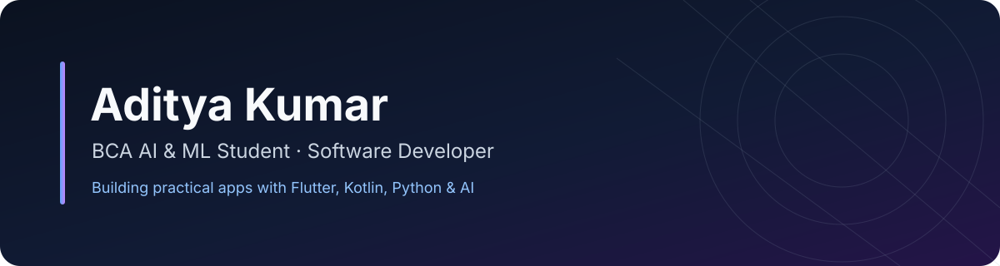

<!-- Profile README for https://github.com/Aditya090908 -->

  

<h1 align="center">Hey, I'm Aditya Kumar 👋</h1>

  <strong>BCA Artificial Intelligence &amp; Machine Learning Student · Software Developer</strong>

  I build practical applications across mobile development, backend engineering, and AI/ML.

---

## About

- 🎓 Pursuing BCA in Artificial Intelligence &amp; Machine Learning at BIT Mesra, Patna campus.
- 🔭 Building **SolveLens**, an AI-powered mathematics-solving application.
- 🌱 Exploring generative AI, backend development, Android development, and computer vision.
- 🏆 Winner of the **AlgoArena Hackathon** (Social Good theme).

## Featured projects

| Project | What it does | Technologies |
|---|---|---|
| [SolveLens](https://github.com/Aditya090908/SolveLens) | AI-powered math-solving app with a Flutter client and a server-side Gemini integration. | Flutter, Dart, FastAPI, Python, Google Gemini |
| [BrainDump](https://github.com/Aditya090908/BrainDump) | Android app for capturing thoughts, organizing ideas, and setting reminders. | Kotlin, Jetpack Compose, Room |
| [PULSE 19](https://github.com/Aditya090908/pulse-19) | Interactive epidemiological dashboard using a local simulated dataset. | React, Vite, Tailwind CSS |

## Tech stack

  
  
  
  
  
  
  
  

## Achievements

- 🥇 Winner — AlgoArena Hackathon, Social Good theme.
- 🌍 Participant — Lovable × ROAM International Hackathon.
- 💻 Completed the 100 Days of Code challenge.

## What I'm interested in

AI-powered products · Mobile applications · Backend systems · Computer vision · Open-source software

---

  <a href="https://github.com/Aditya090908?tab=repositories">Explore my repositories</a>
  &nbsp;·&nbsp;
  <a href="https://github.com/Aditya090908">GitHub profile</a>

